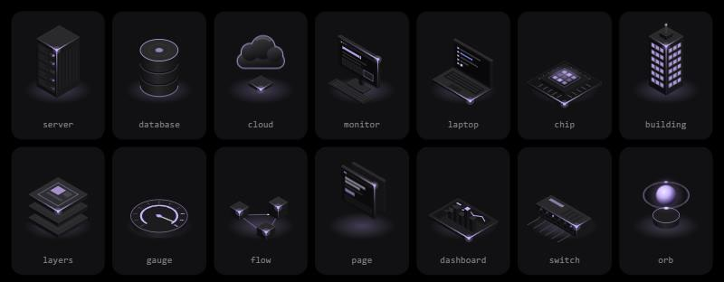

# iso-figures

[English](README.md) · **Español**

Figuras isométricas en SVG para React y la skill que le enseña a Claude a dibujar figuras nuevas
con el mismo estilo: bloques mate, una sola luz de acento y animaciones discretas, para fondos
oscuros o claros.

**[Demo en vivo](https://canojs.github.io/iso-figures/)**



## Qué incluye

- **14 figuras listas**: `server`, `database`, `cloud`, `monitor`, `laptop`, `chip`, `building`,
  `layers`, `gauge`, `flow`, `page`, `dashboard`, `switch` y `orb`. Cada una tiene un estado en
  reposo y una mini demo al activarse (la aguja barre, las barras crecen, las ventanas se
  encienden...).
- **Dos temas**: `dark` para fondos negros o grafito y `light` para fondos blancos. En el claro,
  cada objeto conserva un material realista (hardware en grafito, portátiles de aluminio, edificios
  de hormigón). Todos los colores salen de una paleta por roles, así que cambiar de marca es
  cambiar un objeto.
- **Primitivas** para crear más: proyección isométrica, bloques con borde iluminado, caras,
  planos tumbados, cilindros, segmentos.
- **CSS de animación** sin dependencias, con soporte para `prefers-reduced-motion`.
- **La skill `iso-figures`**: marca, proyección, composición, animación, reglas técnicas y flujo
  de trabajo para que cada figura nueva encaje con las demás. Incluye una batería de evals.

Solo necesita React. No usa Tailwind ni ninguna otra librería.

La skill está escrita en inglés para que sirva a cualquiera, pero Claude te responde en tu idioma.

## Instalar la skill

En Claude Code (2.1.275 o posterior):

```
/plugin install iso-figures --marketplace CanoJS/iso-figures
```

En versiones anteriores, en dos pasos:

```
/plugin marketplace add CanoJS/iso-figures
/plugin install iso-figures
```

O pega esto en Claude:

```
https://github.com/CanoJS/iso-figures

Instala esta skill.
```

O a mano:

```bash
git clone https://github.com/CanoJS/iso-figures.git
cp -r iso-figures/skills/iso-figures ~/.claude/skills/
```

Para un solo proyecto, cópiala en `.claude/skills/` de ese proyecto en lugar de `~/.claude/skills/`.

## Usar las figuras

Con la skill instalada, basta con pedirlo ("añade una figura isométrica de un servidor en la
sección de backend"). Si el proyecto no tiene el kit, Claude lo copia desde
`skills/iso-figures/assets/`.

A mano: copia `iso.ts`, `IsoBox.tsx`, `Figures.tsx` e `iso-figures.css` de
`skills/iso-figures/assets/` a tu proyecto, importa el CSS una vez y usa:

```tsx
import IsoFigure from "./components/iso/Figures";

<IsoFigure kind="server" id="backend" className="h-24 w-24" />
<IsoFigure kind="gauge" id="seo" theme="light" on={activa} className="h-24 w-24" />
```

| Prop | Qué hace |
|---|---|
| `kind` | Qué figura |
| `id` | Único por figura en la página (los degradados lo usan como prefijo) |
| `theme` | `"dark"` (por defecto) o `"light"` |
| `accent` | Color de la luz. Por defecto, el del tema |
| `on` | Activa la mini demo |
| `className` | Tamaño y posición |

Para cambiar la paleta a otra marca, sigue
[`references/brand.md`](skills/iso-figures/references/brand.md) (en inglés). El catálogo con lo
que hace cada figura está en [`references/catalog.md`](skills/iso-figures/references/catalog.md).

## Evals

`evals/` contiene casos que comprueban que la skill produce figuras fieles al estilo (roles de la
paleta, ambos temas, menos movimiento, trigonometría segura para la hidratación). Se ejecutan con:

```bash
claude plugin eval .
```

Última ejecución (1.1.0, una pasada por caso, con y sin la skill):

| Caso | Con | Sin |
|---|---|---|
| `new-figure`: dibujar una figura nueva fiel al estilo | 1.00 | 0.00 |
| `light-theme`: llevar las figuras a una página blanca | 1.00 | 0.00 |
| `rebrand`: cambiar la paleta a otra marca | 1.00 | 0.25 |
| `standalone`: colocar una figura dentro de otro SVG | 1.00 | 0.00 |
| `no-repeat`: no repetir figuras en un mismo sitio | 1.00 | 1.00 |

## Origen

Las figuras nacieron para el portafolio de [Jesús Cano](https://github.com/CanoJS), un tema oscuro
tipo Apple con la luz en violeta.

## Licencia

MIT
