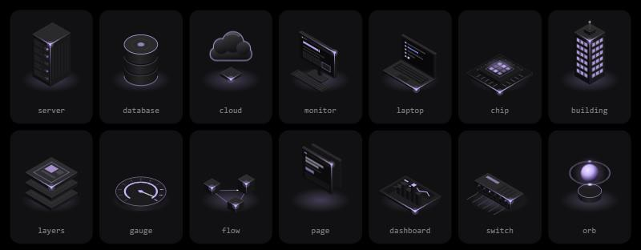

<p align="center">
  <picture>
    <source media="(prefers-color-scheme: light)" srcset="assets/banner-light.svg">
    
  </picture>
</p>

<p align="center">
  <em>Matte blocks, a single accent light, quiet animations. Dark or light.</em>
</p>

<p align="center">
  <a href="https://github.com/CanoJS/iso-figures/releases"></a>
  <a href="LICENSE"></a>
  <a href="https://canojs.github.io/iso-figures/"></a>
  
  
</p>

<p align="center">
  <strong>14 figures &middot; 2 themes &middot; 0 dependencies beyond React &middot; evals 5/5 with the skill vs 1/5 without</strong>
</p>

<p align="center">
  <a href="https://canojs.github.io/iso-figures/"><strong>Live demo</strong></a> &middot;
  <a href="#install-the-skill">Install</a> &middot;
  <a href="#use-the-figures">Use</a> &middot;
  <a href="skills/iso-figures/references/catalog.md">Catalog</a> &middot;
  <a href="README.es.md">Español</a>
</p>

---

Isometric SVG figures for React, plus the skill that teaches Claude to draw new ones in the same
style. Every figure is plain SVG with a rest animation and a mini demo when active, and reads on
dark and light pages.



## What's inside

- **14 ready figures**: `server`, `database`, `cloud`, `monitor`, `laptop`, `chip`, `building`,
  `layers`, `gauge`, `flow`, `page`, `dashboard`, `switch` and `orb`. Each one has a rest state
  and a mini demo when active (the needle sweeps, the bars grow, the windows light up...).
- **Two themes**: `dark` for black or graphite backgrounds and `light` for white ones. On light,
  each object keeps a real-world material (graphite hardware, aluminum laptops, concrete
  buildings). Every color comes from a role-based palette, so rebranding means changing one object.
- **Primitives** to build more: isometric projection, blocks with a lit edge, faces, flat planes,
  cylinders, segments.
- **Animation CSS** with no dependencies, with `prefers-reduced-motion` support.
- **The `iso-figures` skill**: brand, projection, composition, animation, technical rules and a
  workflow so every new figure matches the rest. It also ships an eval suite.

Only needs React. No Tailwind or any other library.

## What you can ask

Once the skill is installed, talk to Claude as you would to a designer who knows the kit:

- *"Add an isometric firewall figure to the security section."*
- *"Our site is moving to a white background, switch the figures."*
- *"Rebrand the figures to our teal, #14B8A6."*
- *"Put a small database on top of this isometric platform."*
- *"Give the pricing cards a figure each, without repeating any."*

## Install the skill

In Claude Code (2.1.275 or later):

```
/plugin install iso-figures --marketplace CanoJS/iso-figures
```

In older versions, in two steps:

```
/plugin marketplace add CanoJS/iso-figures
/plugin install iso-figures
```

Or paste this into Claude:

```
https://github.com/CanoJS/iso-figures

Install this skill.
```

Or by hand:

```bash
git clone https://github.com/CanoJS/iso-figures.git
cp -r iso-figures/skills/iso-figures ~/.claude/skills/
```

For a single project, copy it into that project's `.claude/skills/` instead of `~/.claude/skills/`.

## Use the figures

With the skill installed, just ask ("add an isometric server figure to the backend section"). If
the project does not have the kit yet, Claude copies it from `skills/iso-figures/assets/`.

By hand: copy `iso.ts`, `IsoBox.tsx`, `Figures.tsx` and `iso-figures.css` from
`skills/iso-figures/assets/` into your project, import the CSS once and use:

```tsx
import IsoFigure from "./components/iso/Figures";

<IsoFigure kind="server" id="backend" className="h-24 w-24" />
<IsoFigure kind="gauge" id="seo" theme="light" on={active} className="h-24 w-24" />
```

| Prop | What it does |
|---|---|
| `kind` | Which figure |
| `id` | Unique per figure on the page (gradient ids use it as a prefix) |
| `theme` | `"dark"` (default) or `"light"` |
| `accent` | Light color. Defaults to the theme accent |
| `on` | Plays the mini demo |
| `className` | Size and placement |

To rebrand, follow [`references/brand.md`](skills/iso-figures/references/brand.md). The catalog
with what each figure does is in [`references/catalog.md`](skills/iso-figures/references/catalog.md).

## Evals

`evals/` holds cases that check the skill produces on-brand figures (palette roles, both themes,
reduced motion, hydration-safe math). Run them with:

```bash
claude plugin eval .
```

Latest run (1.1.0, one run per case, with and without the skill):

| Case | With | Without |
|---|---|---|
| `new-figure`: draw a new figure on-brand | 1.00 | 0.00 |
| `light-theme`: move figures to a white page | 1.00 | 0.00 |
| `rebrand`: switch the palette to another brand | 1.00 | 0.25 |
| `standalone`: place a figure inside another SVG | 1.00 | 0.00 |
| `no-repeat`: avoid reusing a figure on one site | 1.00 | 1.00 |

## Origin

The figures were born for the portfolio of [Jesus Cano](https://github.com/CanoJS), an
Apple-style dark theme with a violet light.

## License

MIT
